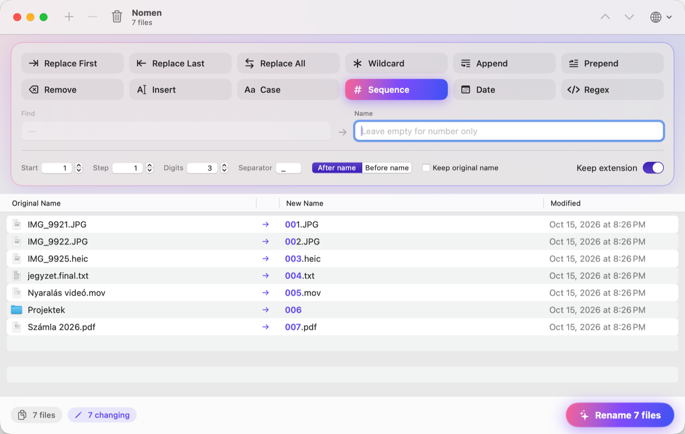
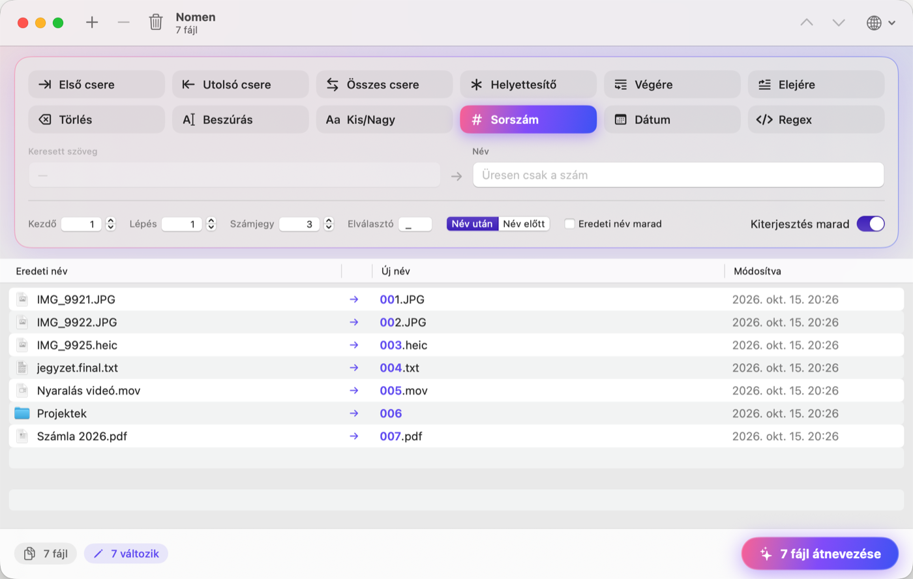

<p align="center">
  
</p>

<h1 align="center">Nomen</h1>

<p align="center">
  Batch file renamer for macOS · Tömeges fájlátnevező macOS-re<br>
  <a href="#english">English</a> · <a href="#magyar">Magyar</a>
</p>

---

## English

Nomen renames many files and folders at once. You see every new name before anything changes on disk. It was inspired by NameChanger, and it keeps the file extension when you number files.



### Features

- **12 rename modes:** replace first / last / all occurrences, wildcard (`*`, `?`), append, prepend, remove characters, insert characters, change case, sequence, date, regular expression (with `$1`, `$2` groups)
- **Sequence mode:** set the start number, step, digit count (`001`, `002` …), separator and position, and optionally keep the original name. It follows the list order, which you can sort or rearrange.
- **Keeps the extension:** rules change only the name by default, so `IMG_9921.JPG` becomes `Holiday_001.JPG`. This can be switched off.
- **Live preview:** the part of each name that will change is highlighted.
- **Conflict detection:** duplicate names, existing files and invalid characters are marked in red, and renaming is blocked until they are fixed.
- **Safe renaming:** swaps (a→b, b→a) and case-only renames work. If an error occurs, every file gets its original name back, and the last rename can be undone (⌥⌘Z).
- **Adding files:** drag them into the window, drop them on the Dock icon, use *Open With → Nomen*, or press ⌘O.
- **English and Hungarian interface,** switchable at any time with the 🌐 button.
- Uses the same keyboard shortcuts as NameChanger (⌃⌘F, ⌃⌘S, ⌃⌘R …).

### Requirements

macOS 14 Sonoma or later.

### Build from source

You need Xcode or the Swift 5.10+ toolchain.

```bash
git clone https://github.com/Ekidio/Nomen.git
cd Nomen
./build-app.sh                    # builds build/Nomen.app
cp -R build/Nomen.app /Applications/
```

The app is ad-hoc signed and not notarized. On first launch, right-click Nomen.app and choose **Open**.

```bash
swift test                        # runs the tests
swift Scripts/make-icon.swift .   # regenerates the app icon
```

---

## Magyar

A Nomen egyszerre sok fájlt és mappát nevez át. Minden új nevet előre látsz, és a lemezen semmi sem változik, amíg rá nem kattintasz az Átnevezésre. A NameChanger ihlette, de sorszámozáskor nem veszíti el a fájlok kiterjesztését.



### Funkciók

- **12 átnevezési mód:** első, utolsó vagy összes előfordulás cseréje, helyettesítő karakterek (`*`, `?`), hozzáfűzés a végére vagy az elejére, karakterek törlése és beszúrása, kis- és nagybetűk, sorszámozás, dátum, reguláris kifejezés (`$1`, `$2` csoportokkal)
- **Sorszámozás:** beállítható a kezdőszám, a lépésköz, a számjegyek száma (`001`, `002` …), az elválasztó és a szám helye, és az eredeti név is megtartható. A számozás a lista sorrendjét követi, ami rendezhető és kézzel is átrendezhető.
- **Megmarad a kiterjesztés:** a szabályok alapból csak a nevet módosítják, így az `IMG_9921.JPG` fájlból `Nyaralas_001.JPG` lesz. Ez kikapcsolható.
- **Élő előnézet:** a név megváltozó része ki van emelve.
- **Ütközések jelzése:** az azonos nevek, a már létező fájlok és a tiltott karakterek pirossal jelennek meg, és amíg ezeket nem javítod, az átnevezés nem indítható el.
- **Biztonságos átnevezés:** működik a névcsere (a→b, b→a) és a csak kis- és nagybetűben eltérő átnevezés is. Hiba esetén minden fájl visszakapja az eredeti nevét, az utolsó átnevezés pedig visszavonható (⌥⌘Z).
- **Fájlok hozzáadása:** húzd be őket az ablakba, dobd rá a Dock-ikonra, használd a *Megnyitás ezzel → Nomen* parancsot, vagy nyomd meg a ⌘O-t.
- **Magyar és angol felület,** a 🌐 gombbal bármikor váltható.
- Ugyanazok a billentyűparancsok, mint a NameChangerben (⌃⌘F, ⌃⌘S, ⌃⌘R …).

### Követelmények

macOS 14 Sonoma vagy újabb.

### Fordítás forráskódból

Xcode vagy a Swift 5.10+ eszközkészlet kell hozzá.

```bash
git clone https://github.com/Ekidio/Nomen.git
cd Nomen
./build-app.sh                    # elkészíti a build/Nomen.app-ot
cp -R build/Nomen.app /Applications/
```

Az app ad-hoc aláírású, és nincs notarizálva. Első indításkor kattints jobb gombbal a Nomen.app-ra, és válaszd a **Megnyitás** lehetőséget.

```bash
swift test                        # lefuttatja a teszteket
swift Scripts/make-icon.swift .   # újra legenerálja az ikont
```
